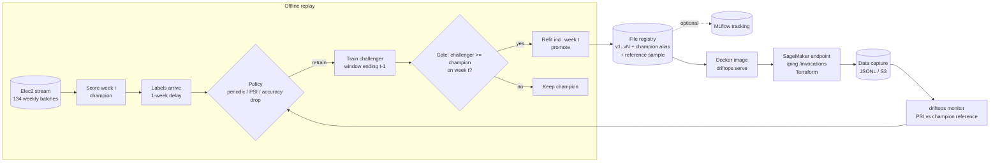

# driftops: when should a production model be retrained?

[](https://github.com/Adversitas/elec2-drift-mlops/actions/workflows/ci.yml)

An MLOps study and toolkit for the part of the model lifecycle that happens **after**
deployment: monitoring data drift, deciding when to retrain, gating a challenger against the
champion, versioning models, and serving them behind a **SageMaker-compatible container**
provisioned with **Terraform**.

The questions are answered with measurements, not opinions, by replaying a real
non-stationary stream: **Elec2**, 2.5 years of the New South Wales electricity market (45,312
half-hours, 1996 to 1998, target = will the price go UP or DOWN vs its 24-hour average). The
stream is cut into 134 weekly batches. Each week the deployed model scores the batch *before*
the labels are known, then the labels arrive (one-week delay) and the retraining policy decides
what to do. No look-ahead anywhere.

## Results

130 weeks scored after 4 warm-up weeks. Produced by `driftops benchmark`
(full table: [`reports/results.md`](reports/results.md); per-week CSVs are regenerated locally).
*Model fits* is the compute cost (every training run, including challengers that were rejected).

| Policy | Logistic regression: mean weekly accuracy | worst 10 % of weeks | model fits | Gradient boosting: mean weekly accuracy | worst 10 % of weeks | model fits |
|---|---|---|---|---|---|---|
| static (train once) | 0.697 | 0.567 | 2 | 0.634 | 0.518 | 2 |
| periodic, every 4 weeks (8-week window) | 0.774 | 0.646 | 34 | 0.764 | 0.651 | 34 |
| **weekly (8-week window)** | **0.785** | 0.666 | 132 | **0.776** | **0.675** | 132 |
| weekly, all history (expanding window) | 0.753 | 0.610 | 132 | 0.771 | 0.672 | 132 |
| PSI-triggered (any feature PSI > 0.25) | 0.785 | 0.666 | 258 | 0.776 | 0.675 | 258 |
| accuracy-triggered, drop > 5 pts | 0.729 | 0.562 | 18 | 0.711 | 0.570 | 18 |
| accuracy-triggered, drop > 2 pts | 0.729 | 0.562 | 26 | 0.720 | 0.570 | 28 |
| accuracy-triggered, drop > 2 pts **+ champion/challenger gate** | 0.757 | 0.626 | 25 | 0.740 | 0.633 | 29 |
| *reference: persistence (previous half-hour's label)* | *0.853* | | | | | |

What the numbers say:

- **Never retraining costs 9 to 14 accuracy points.** The static model falls to 0.63 to 0.70,
  and its worst weeks are below coin-flip (0.36 for gradient boosting). The concept drifts.
- **Recent data beats more data.** Retraining weekly on the last 8 weeks is the best policy for
  both models. Training on all history is worse for logistic regression (0.753 vs 0.785): old
  regimes pull the decision boundary in the wrong direction.
- **Raw-feature PSI is a useless trigger on this stream.** Prices and demand shift every week,
  so the PSI alarm fired in 128 of 130 weeks. It ends up as an expensive weekly retrain (258
  fits, because each alarm also trains a challenger). Against the warm-up reference, the price
  PSI exceeds 0.25 in **100 %** of weeks. Feature drift is not the same as performance drift.
- **Accuracy-based triggers save 78 to 86 % of the training compute and cost 3 to 7 points.**
  With a 2-point threshold and a gate, gradient boosting retrains 13 times instead of 130 and
  reaches 0.740 instead of 0.776.
- **The champion/challenger gate is worth having.** Same trigger, same number of fits, but
  refusing challengers that do worse on the newest labelled week adds 2.0 to 2.8 points and lifts
  the worst weeks by 6 points.
- **A one-line baseline beats every model: 0.853.** Predicting "same as the last half-hour"
  wins because the label is strongly autocorrelated. It needs labels in real time, whereas the
  models above work with a one-week label delay. If real-time labels are available, the right
  production move is to add lagged labels as features, not to tune the retraining policy.

## Architecture



| Module | Role |
|---|---|
| `data.py` | ARFF reader, cyclic time features, weekly batching |
| `monitoring.py` | PSI (quantile bins, constant-reference case), KS test, `DriftMonitor` (feature PSI and delayed-label accuracy) |
| `simulate.py` | Prequential replay of every policy, champion/challenger gate, persistence baseline, drift profile |
| `registry.py` | Versioned model registry with champion alias and a reference sample per version; optional MLflow mirroring |
| `serve.py` | FastAPI app implementing the SageMaker container contract (`GET /ping`, `POST /invocations` with JSON or CSV) and request capture |
| `cli.py` | `driftops benchmark / train / monitor / serve` |
| `Dockerfile` | Inference image; `docker run <image> serve` as SageMaker expects, model read from `/opt/ml/model` |
| `infra/terraform` | ECR repository, encrypted S3 bucket, IAM role, SageMaker model, endpoint config with data capture, endpoint |

## How to run

```bash
pip install -e ".[dev]"                 # add ".[tracking]" for MLflow
driftops benchmark --out reports        # full replay, both models, all policies
driftops benchmark --mlflow             # same, mirrored to an MLflow experiment

driftops train --model hgb --registry artifacts/registry   # registers v1 and promotes it
driftops serve --registry artifacts/registry --port 8080
curl localhost:8080/ping
curl -X POST localhost:8080/invocations -H "content-type: text/csv" \
     --data-binary "3,0.5,0.06,0.42,0.003,0.42,0.41,0.0,-1.0"
driftops monitor --registry artifacts/registry --capture artifacts/capture.jsonl  # exit 2 = drift

docker build -t driftops . && docker run -p 8080:8080 -v $PWD/model:/opt/ml/model driftops
cd infra/terraform && terraform init && terraform plan
pytest -q && ruff check . && ruff format --check .
```

CI runs lint, format and tests on Python 3.10 and 3.12, a 20-week replay, a train/serve smoke
test against the real HTTP contract, `terraform fmt`/`validate`, and a Docker build.

## Limitations

- **One stream.** Elec2 is the classic concept-drift benchmark, but conclusions about window
  length and thresholds are specific to it. The harness is reusable; the numbers are not.
- The dataset ships min-max normalised, and its Victoria columns (`vicprice`, `vicdemand`,
  `transfer`) are constant for the first 17,424 rows (missing values replaced by the publisher). That shows up as drift. It is real
  in the data, but it is a data-quality artefact rather than a market change.
- Thresholds (PSI 0.25, 2 and 5 accuracy points) were not tuned; a sweep would sharpen the
  cost/accuracy frontier.
- Wall-clock times are not reported in the table because the benchmark shared the CPU with
  other jobs; model fits are the reliable cost measure.
- The Terraform stack is validated in CI but has **not been applied** to a real AWS account,
  and packaging the registry version as `model.tar.gz` for S3 is left to a deployment script.
- The registry is file-based (MLflow is optional) to keep the project self-contained.

## En bref (FR)

Étude et boîte à outils **MLOps** sur la vie d'un modèle après sa mise en production :
surveillance de la dérive (PSI, KS, précision avec labels différés), politiques de
réentraînement, porte champion/challenger, registre de modèles versionné, conteneur d'inférence
**compatible SageMaker** et infrastructure **Terraform** (ECR, S3, IAM, endpoint avec data
capture). Mesuré sur le flux réel **Elec2** (marché de l'électricité australien, 134 semaines) :
ne jamais réentraîner coûte 9 à 14 points de précision ; réentraîner chaque semaine sur les 8
dernières semaines est le meilleur choix (0,785) ; le PSI sur les variables brutes déclenche
presque chaque semaine et n'apporte rien ; un déclenchement sur baisse de précision avec porte
champion/challenger économise environ 80 % des entraînements pour 3 à 4 points de moins.
Une base naïve (« même tendance qu'il y a 30 minutes ») atteint 0,853 : elle exige des labels en
temps réel, que les modèles n'ont pas ici.

## License

MIT. Elec2 (Harries 1999, OpenML id 151) is redistributed in normalised form as published on
OpenML.
